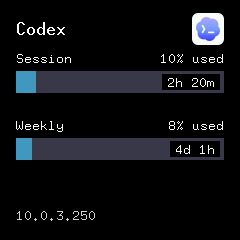

# geekmagic-tokens

Rust firmware that turns a GeekMagic SmallTV Pro into a standalone Codex and Claude Code usage display. It joins Wi‑Fi, keeps its own Codex and Claude logins, and polls the 5-hour session and weekly limits (Codex every minute, Claude every 5 minutes). No computer is needed once it is set up.



- Bars show percent used, with a reset countdown in the corner (`3h 20m`, `4d 1h`).
- A tap on the top of the case switches between the Codex and Claude Code screens.
- The footer shows the device IP, or `Updated Xm ago` once the last reading is more than 3 minutes old (7 for Claude).

## Hardware

SmallTV Pro (ESP32, 8 MB flash, 240×240 ST7789, capacitive touch pad on the top). USB‑C is power only; the serial port is a UART header inside the case, needed only for recovery.

| GPIO | Use |
|---|---|
| 18, 23 | SPI clock, MOSI |
| 3 | Display chip select (also UART0 RX, so serial input stops once the display starts) |
| 2, 4 | Display DC, reset |
| 21 | Backlight |
| 32 (T9) | Touch pad |

Some board revisions wire the display to HSPI (clock 14, MOSI 13). If the panel stays blank after flashing, change those two pins in `src/main.rs`.

## Setup

One-time host setup installs the Xtensa Rust toolchain, `espflash` and `ldproxy`:

```sh
./setup.sh
```

Then create `.env` (gitignored, since the values end up in the firmware):

```sh
WIFI_SSID=your-network
WIFI_PASS=your-password
DEVICE_TOKEN=$(openssl rand -hex 16)   # paste the generated value
```

`DEVICE_TOKEN` protects the endpoints that change the device. The build fails without it.

## Installing

**First time, from the stock firmware.** Build the image, then upload `dist/geekmagic-tokens.bin` through the stock updater at `http://<device-ip>/update` (the stock firmware shows its IP on screen):

```sh
./ota.sh <device-ip>   # builds dist/geekmagic-tokens.bin; the final upload fails on stock, which is fine
```

**After that,** every build goes over Wi‑Fi:

```sh
./ota.sh                # defaults to 10.0.3.250
```

The device reboots into the new image in a few seconds and shows its IP once it is back on Wi‑Fi.

## Signing in to Codex

The device needs its own Codex login. Don't copy your laptop's `~/.codex/auth.json`: OpenAI rotates refresh tokens on every refresh, so two holders of one login keep signing each other out.

```sh
CODEX_HOME=.device-auth codex login --device-auth   # approve the code at auth.openai.com/codex/device
. ./.env
curl -H "X-Device-Token: $DEVICE_TOKEN" --data-binary @.device-auth/auth.json http://10.0.3.250/auth
rm .device-auth/auth.json   # the device rotates the token straight away, so this copy is dead
```

The device stores the refresh token in NVS, refreshes it itself, and saves each new one before using it. Repeat these steps if the screen says `Sign in again`.

## Signing in to Claude

The device reads the same numbers as Claude Code's `/usage`, from its own token:

```sh
scripts/claude-login.sh   # prints a sign-in link, asks for the code#state, checks the token
. ./.env
curl -H "X-Device-Token: $DEVICE_TOKEN" --data-binary @.device-auth/claude.json http://10.0.3.250/auth/claude
```

The script mints a 1-year access token with only the `user:profile` scope, so it can read usage but can't run models. The device never refreshes it: Claude's refresh chain expires about 30 days after sign-in, and a refresh would swap the 1-year token for an 8-hour one. Run the script again once a year, or when the Claude screen says `Sign in again`. The recipe comes from [claude-usage-epaper](https://github.com/Pharkie/claude-usage-epaper).

## Endpoints

| Method and path | Token | What it does |
|---|---|---|
| `GET /status` | no | Uptime, last redraw, Wi‑Fi join stats, poll count, last error, current reading |
| `GET /debug/screen.bmp` | no | Renders what the panel currently shows |
| `POST /update` | yes | Raw app image (body) → OTA write and reboot |
| `POST /auth` | yes | Codex `auth.json` (body) → stored in NVS, polls immediately |
| `POST /auth/claude` | yes | `.device-auth/claude.json` (body) → access token stored in NVS, polls immediately |
| `POST /debug/brightness?percent=N` | yes | Overrides the backlight; `percent=0` goes back to the day/night schedule |
| `POST /debug/pause?secs=N&age=S` | yes | Stops polling for N seconds and backdates the reading by S seconds |
| `POST /debug/drop?secs=N` | yes | Drops Wi‑Fi and holds off reconnecting for N seconds |

Send the token as `X-Device-Token: $DEVICE_TOKEN`.

## How it works

```mermaid
flowchart TB
    subgraph main thread
        T[touch.rs<br/>tap detect] --> L[draw loop]
        L --> D[display.rs<br/>ST7789, 8-row strips] --> U[ui.rs]
    end
    subgraph net thread
        N[net.rs<br/>Wi-Fi + HTTP server] --> P[usage.rs<br/>poll loop]
        P --> C[codex.rs] & A[claude.rs]
    end
    P -- shared State --> L
    N -- /auth, /auth/claude, reconnect --> P
    Mac -. ota.sh / curl .-> N
    C <-- HTTPS --> O[auth.openai.com<br/>chatgpt.com]
    A <-- HTTPS --> K[api.anthropic.com]
```

- `main.rs` sets up the panel and touch pad, then runs the draw loop: redraw on a tap, on new data, and every 30 s so countdowns tick. Wi‑Fi starts on a background thread so the button works while it connects.
- `net.rs` joins Wi‑Fi (retrying until it has an address), rejoins after drops, and serves the endpoints.
- `usage.rs` holds the shared state and polls Codex every minute and Claude every 5 minutes, one after the other so only one TLS session uses RAM at a time.
- `codex.rs` refreshes the token at `auth.openai.com/oauth/token` and reads `chatgpt.com/backend-api/wham/usage`, the same endpoints and client ID the Codex CLI uses. `primary_window` is the session and `secondary_window` the weekly limit.
- `claude.rs` reads `api.anthropic.com/api/oauth/usage` (`five_hour`, `seven_day`), the endpoint behind Claude Code's `/usage`. It sends a `claude-code/<version>` User-Agent, without which the endpoint throttles to about one request an hour.
- `backlight.rs` dims the backlight with PWM: 70% by day, 10% from 22:00 to 07:00 Singapore time, once SNTP has set the clock.
- `display.rs` drives the ST7789 directly and renders 8 rows at a time to leave RAM for TLS.
- `ui.rs` draws the screens with `embedded-graphics`.

Both quota endpoints are internal (ChatGPT's and Anthropic's) and could change without notice. If it does, `/status` will show the parse or HTTP error.

## Logos

`assets/codex.raw` and `assets/claude-code.raw` are 32×32 big-endian RGB565 images drawn on black, generated from the SVGs next to them (from [Lobe Icons](https://github.com/lobehub/lobe-icons)):

```sh
swift scripts/logo.swift assets/codex.svg 32 assets/codex.raw preview.png
```

## Recovery

If OTA is unreachable (bad image, wrong Wi‑Fi), flash over the UART header with a USB serial adapter: hold GPIO0 low at power-on, then

```sh
espflash flash --chip esp32 target/xtensa-esp32-espidf/release/geekmagic-tokens
```

To go back to stock, the vendor image is `firmware/PRO_V3.3.75EN` in [GeekMagicClock/smalltv-pro](https://github.com/GeekMagicClock/smalltv-pro); check it against the published MD5 before flashing.

## Troubleshooting

- **Usage request fails with `ESP_FAIL`:** the access token is about 1.8 KB, so the HTTP client needs `buffer_size_tx` of 4 KB (already set in `codex.rs`).
- **Build changes to `sdkconfig.defaults` don't apply:** `ESP_IDF_SDKCONFIG_DEFAULTS` in `.cargo/config.toml` points at it; touching the file triggers an ESP-IDF rebuild, which needs network access to Espressif and PyPI.
- **Xtensa LLVM crash deserializing JSON:** use `f64`, not `f32`, for floats.
