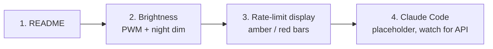
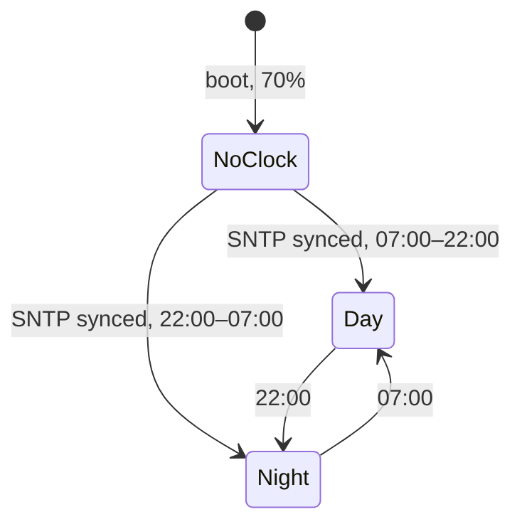

# Next steps plan

Four items, done in this order: README, brightness, rate-limit display, Claude Code usage. Each item ends with an OTA push, a check through `/status` and `/debug/screen.bmp`, and a commit.



## 1. README

Write `README.md` covering what someone needs to rebuild, reflash or recover the device without this conversation.

1. What it is: a standalone Codex usage display on a GeekMagic SmallTV Pro, with a photo of the screen.
2. Host setup: `./setup.sh`, the `.env` file (`WIFI_SSID`, `WIFI_PASS`, `DEVICE_TOKEN`), and why it is gitignored.
3. First install: upload `dist/geekmagic-tokens.bin` through the stock updater at `http://<ip>/update`. After that, use `./ota.sh`.
4. Signing in: the separate `CODEX_HOME=.device-auth codex login --device-auth` login, why it must not share the laptop's login (refresh tokens rotate), and the `curl` to `/auth`.
5. Endpoint table: `/update`, `/auth`, `/status`, `/debug/screen.bmp`, `/debug/pause`, `/debug/drop`, and which ones need `X-Device-Token`.
6. Architecture: a short module map and the diagram below.
7. Recovery: the UART header for when OTA is unreachable, the stock image (V3.3.75EN from GeekMagicClock/smalltv-pro), and the alternative HSPI pinout if the panel stays blank.
8. Logos: regenerating `assets/*.raw` with `scripts/logo.swift`.

```mermaid
flowchart TB
    subgraph main thread
        T[touch.rs<br/>tap detect] --> L[draw loop]
        L --> D[display.rs<br/>ST7789 strips] --> U[ui.rs]
    end
    subgraph net thread
        N[net.rs<br/>Wi-Fi + HTTP server] --> C[codex.rs<br/>refresh + poll]
    end
    C -- State --> L
    N -- /auth, reconnect --> C
    Mac -. ota.sh / curl .-> N
    C <-- HTTPS --> O[auth.openai.com<br/>chatgpt.com]
```

## 2. Brightness with night dimming

The backlight on GPIO21 is currently switched fully on. Drive it with LEDC PWM and pick the level from local time.

1. Replace the backlight `PinDriver` with an LEDC channel at about 5 kHz. Add `display::set_brightness(percent)`.
2. Start SNTP (`EspSntp`) once Wi‑Fi is up. Set `TZ=SGT-8` (Asia/Singapore, no daylight saving).
3. In the draw loop, compute the target level every 30 s: 70% from 07:00 to 22:00, 10% from 22:00 to 07:00. Until the clock syncs, stay at the day level.
4. Keep the levels and hours as constants in one place. A `.env` override can come later if needed.
5. Add `brightness: N% (day|night|no clock)` to `/status`.
6. Check: read `/status` for the level, confirm on the panel that 70% is comfortable, and test the night level with a temporary debug override.



## 3. Rate-limit display

`/wham/usage` already returns `rate_limit.allowed`, `rate_limit.limit_reached` and each window's `used_percent`.

1. Parse `allowed` and `limit_reached` into `Reading`.
2. Bar colour by usage: the current blue below 80%, amber from 80%, red at 100% or when that window is exhausted.
3. When a window is exhausted, replace its `N% used` label with `Limit reached` in red and keep its reset countdown.
4. Add `limit reached: yes/no` to `/status`.
5. Check: render a fake reading through a temporary debug hook, or wait for a real 80% session, and inspect `/debug/screen.bmp`.

## 4. Claude Code usage

Decision: keep the placeholder.

The only supported source today is Claude Code's status line, which gives `rate_limits.five_hour` and `rate_limits.seven_day` (`used_percentage`, `resets_at`) to a script on the computer running Claude Code. The display can't fetch that on its own. A push from the Mac was considered and declined.

1. No firmware work now. The screen keeps the Claude Code logo and "Claude setup unavailable".
2. Revisit if Anthropic publishes an API the device can poll with its own credentials. The UI already has the bar and countdown code to reuse.
